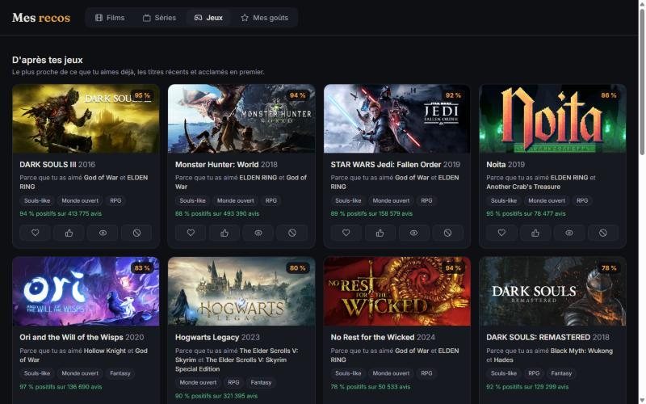
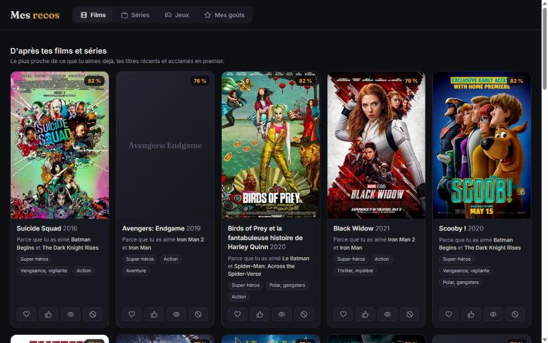

# tastebridge

**Movie, TV show and video game recommendations that cross the line between screens.**
Liked *The Dark Knight*? Here are crime-noir superhero games. Played *Dying Light*? Here are zombie films.
**Try it in your browser: https://rayancv94.github.io/tastebridge/** (no account: your ratings stay in your browser).
Or run it locally, no account, no API key, no tracking.

*Version française plus bas.*



## Why I built it

Streaming platforms only recommend inside their own catalogue, and one medium at a time.
But my taste is not tied to a medium: when I love a dark, atmospheric story in a film, I often love the same thing in a game, and the other way around. Except when I don't: I can love a genre in games and not care about it in films.
So I built **one taste profile across films, series and games** that recommends in two ways:

- **within a medium** (games from my games, films from my films);
- **across media** (games from my films, films from my games), with the reason on every card: *"because you liked X and Y"*.

## How it works

I wanted something simple, explainable and light (no local LLM eating my GPU), so I went with a content-based approach:

1. **Catalogue** (`construire.py`): ~3,600 films and ~2,400 series from [Wikidata](https://www.wikidata.org) (genres and main subjects), ~2,500 well-reviewed Steam games from [SteamSpy](https://steamspy.com) (community tags, review ratio), posters from Wikipedia. All free, open sources, no key.
2. **Shared theme vocabulary** (`themes.py`): Wikidata genres and Steam tags are mapped onto 27 common themes (horror, cyberpunk, heist, open world, souls-like...). This is the bridge between media.
3. **Vectors**: each title becomes a TF-IDF-weighted theme vector, so rare themes (Western) weigh more than ubiquitous ones (Action).
4. **Profile**: weighted sum of the vectors of what you rated (loved +2, liked +1, watched +0.5, disliked -1, hated -2).
5. **Ranking**: cosine similarity between profile and candidates, multiplied by a quality score (Wikipedia language coverage for screens, Steam review ratio and volume for games) and a recency factor that keeps acclaimed classics.
6. Already seen / owned titles are excluded automatically.

## Evaluation

To check that it actually works, I wrote a leave-one-out test (`python evaluer.py`): I hide one title I liked, compute recommendations from the rest of my profile, and look at the rank where the hidden title comes back.

Results on my own profile (37 liked titles):

| method | Hit@10 | Hit@50 | median rank |
|---|---|---|---|
| **themes (this project)** | **35 %** | **46 %** | **57** |
| most popular first | 5 % | 35 % | 117 |
| random | 0 % | 3 % | 1128 |

What I learned and what is still limited: it is tested on one person (me) with a small profile; it only uses themes, so there is no collaborative filtering ("people who liked X also liked Y"); and Wikidata genres are sometimes noisy (a kids' film tagged "vigilante"). Collaborative filtering on public ratings is my next step.

## Import your history

In the **Mes goûts** tab, drop a CSV export. Files are read on your machine, nothing is uploaded.

| Source | How to get the file | What is used |
|---|---|---|
| Netflix | in a web browser, netflix.com/viewingactivity > pick your profile > *Download all* at the bottom (`NetflixViewingHistory.csv`) | titles watched; a series with 3+ episodes counts as liked |
| Netflix ratings | Account > *Download your personal information* > `Ratings.csv` | thumbs up / down / double up |
| IMDb | Your ratings > ... > *Export* | your 1-10 ratings, including video games |
| Letterboxd | Settings > Data > *Export your data* (`ratings.csv`, `watched.csv`) | your 0.5-5 ratings |
| Prime Video, others | Amazon has no export button: request your data from Amazon, or any CSV with a `Title` column | titles watched |
| Steam | nothing to do: games installed or played on this PC are read from Steam's local files | excluded from recommendations |

I wanted a "connect with Netflix" button, but Netflix, Prime Video and Disney+ have no public API, so the clean way is their CSV export. Prime Video has no export button: you have to request your data from Amazon, which takes a few days.

Optional, in `donnees/config.json` (never committed):

```json
{
 "jellyfin": {"url": "http://localhost:8096", "cle": "YOUR_JELLYFIN_API_KEY", "utilisateur": "YourName"},
 "listes_jeux_possedes": [{"fichier": "~/games.xlsx", "feuille": "Owned", "colonne": 2}]
}
```

## Run it

The website (`docs/`, GitHub Pages) runs the same engine in JavaScript (`moteur.js`) with no server: your ratings live in your browser's storage, and you can save them to a file and load them on another device. I chose no accounts on purpose: no password stored anywhere means nothing to leak. `python site.py` regenerates it.

The local version adds automatic Steam and Jellyfin detection:


```bash
pip install -r requirements.txt
python recos.py
```

The page opens at http://127.0.0.1:5077. On Windows, double-click `lancer.vbs` to start it without a console window.
The server stops by itself 3 minutes after the page is closed: nothing runs in the background.

Rebuild the catalogue (about 1 hour, mostly polite SteamSpy rate limits): `python construire.py`, or `--jeux` / `--affiches` for one part.

## Privacy and security

- The server listens on `127.0.0.1` only: not reachable from your network or the internet.
- Requests from other websites are refused (Host and Origin checks, custom header required to write), so a malicious page cannot read or change your profile.
- Your ratings, settings and logs live in `donnees/`, which is git-ignored.
- No API key is needed or stored in the code. The only outgoing requests are poster images loaded by your browser (Wikipedia, Steam CDN).

## Data and licences

Code: MIT. Wikidata content is CC0. Game data comes from SteamSpy. Posters are not stored: the catalogue only keeps their Wikipedia URLs, and they remain the property of their rights holders.

---

## Version française

**J'ai créé ce projet parce que je voulais des recommandations qui passent d'un écran à l'autre** : des jeux d'après les films que j'aime, des films d'après mes jeux. Les plateformes ne recommandent que dans leur catalogue et un seul support à la fois. Tout tourne en local, sans compte ni clé.

- Un seul profil de goûts pour films, séries et jeux, avec deux sortes de recos : dans le même domaine, et d'un domaine à l'autre, chaque fois avec la raison (« parce que tu as aimé X et Y »). Je peux aimer un genre en jeu et pas en film, d'où la séparation.
- Méthode : 27 thèmes communs (horreur, cyberpunk, braquage, monde ouvert...), vecteurs TF-IDF, similarité cosinus, pondérée par la qualité (avis Steam, couverture Wikipédia) et la récence.
- Pour vérifier que ça marche, j'ai fait une évaluation « leave-one-out » sur mon propre profil : je cache un titre que j'ai aimé, et il ressort dans le top 10 dans 35 % des cas, contre 5 % pour « les plus populaires d'abord » et 0 % au hasard. Limites : testé sur moi seul, et pas encore de filtrage collaboratif (prochaine étape).
- Import d'historique : Netflix (netflix.com/viewingactivity, « Télécharger tout »), IMDb, Letterboxd, ou tout CSV avec une colonne Title ; Steam est lu tout seul. Prime Video : demande de données à Amazon, plusieurs jours.
- Site : https://rayancv94.github.io/tastebridge/ (sans compte : tes goûts restent dans ton navigateur, sauvegardables dans un fichier).
- Lancer en local : `pip install -r requirements.txt` puis `python recos.py` (ou double-clic sur `lancer.vbs` sous Windows). La page s'ouvre, et le serveur s'arrête seul 3 minutes après sa fermeture.


